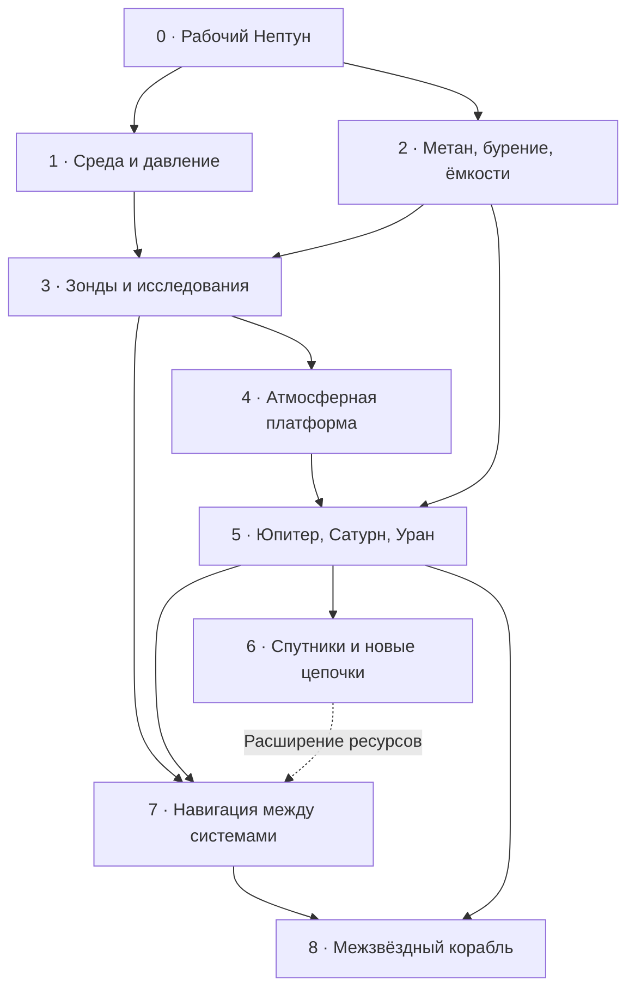

# BeyondTheHorizons — Roadmap

> **Статус:** рабочая дорожная карта; не список анонсированных релизов. Порядок этапов — рекомендуемый план реализации, не сроки. Нереализованные механики отмечены явно.
>
> **Направление:** самостоятельное расширение Ad Astra о промышленном освоении Солнечной системы и подготовке к **полёту в другую звёздную систему**. Основной интерес — *как* игрок добывает, исследует, хранит, транспортирует и использует ресурсы, а не просто новые уровни ракет и руды.
>
> **Глассио** и существующий способ полёта к ней **исключены из этой прогрессии**. Их будущая роль — отдельное решение, без автоматического переноса текущей механики в межзвёздный проект. Концепция не опирается на дизайн других аддонов планет.

## 1. Текущее состояние

| Система | Статус | Что уже есть / чего ещё нет |
| --- | --- | --- |
| Лунные жеоды и лазерный бур | 🟡 Реализовано, ждёт игрового теста | Новый кристалл, ванильная геода в лунном биоме, энергетический бур; без ретрогенерации |
| NeoForge 1.21.1, CI | ✅ Реализовано | Сборка JAR в GitHub Actions; публикация на площадки не входит в этот этап |
| Нептун и орбита | ✅ Реализовано | Планета Ad Astra, капсула и доступное измерение |
| Нептун: поверхность и океан | ✅ Реализовано | Плотный/синий лёд, шум рельефа, глубокая вода, дно, защита от случайного замерзания Ad Astra |
| Нептун: биомы | ✅ Реализовано | Cobalt Plains, Methane Drifts, Neptunian Ocean, Pressure Abyss; текущие блоки ванильные |
| Нептун: останки огромных существ | ⬜ Концепт | Редкие скелетные структуры по мотивам ископаемых останков Нижнего мира; проработать позднее |
| Реальный ресурс «метан» | ⬜ Не реализовано | Сейчас Methane Drifts содержит снег и лёд, а не метановые месторождения |
| Давление и защита от него | 🟡 Основа реализована | Есть давление, собственный тип урона, атрибут устойчивости и отладка; скафандры и защищённый транспорт ещё не добавлены |
| Зонды, платформы, атмосферная добыча | ⬜ Не реализовано | Пока существуют только концепции |
| Юпитер, Сатурн, Уран и дополнительные спутники | ⬜ Не реализовано | Это будущие направления |
| Межзвёздная навигация и корабль | ⬜ Не реализовано | Требуют отдельных систем и исследовательской прогрессии |

**Проверка состояния:** исходники BeyondTheHorizons и документы в `docs/planning/`, 17 ноября 2026. Наличие кода и успешная компиляция предыдущих версий не заменяют полноценного игрового тестирования новых механик.

## 2. Игровые принципы

- **На газовых гигантах нет обычной поверхности.** Капсула садится на безопасную стартовую платформу над облаками. Платформа становится базой, которую игрок расширяет; исследования проводятся через зонды и оборудование.
- **Высота — важная часть геймплея.** Давление, температура, ветер, радиация и состав среды различаются по высотам; отдельные классы зондов пригодны лишь для определённых диапазонов.
- **Опасность преодолевается техникой**, а не просто новой ступенью брони: герметичные отсеки, аппараты, датчики, защитные костюмы, стабилизаторы и ретрансляторы.
- **Нептун — уже реализованная художественная интерпретация ледяного гиганта.** Сохраняем ледяную поверхность, океан, Methane Drifts и Pressure Abyss. Не переделываем его в ещё один газовый мир.
- **Останки гигантских существ на Нептуне — будущая атмосферная деталь.** Предусмотреть редкие крупные скелетные останки как природные структуры по аналогии с ископаемыми костями в Нижнем мире Minecraft. Расположение, размеры, происхождение существ, состав блоков, добыча и возможный сюжетный смысл пока не определены; на этом этапе не связывать с обязательной прогрессией.
- **Вещества имеют состояния и логистику.** Твёрдый, жидкий и газообразный метан — один ресурс с разными способами добычи, хранения и перевозки, а не три несвязанных предмета.
- **Зонды дают знания и ресурсы.** Телеметрия и исследования — часть технологического развития, а не только декоративная анимация.
- **Межзвёздный проект — результат освоения**, а не крафт одного предмета Tier 5: нужны энергия, двигательная система, защита, жизнеобеспечение, научные данные и **навигация, работоспособная в других звёздных системах**.
- **Производительность и безопасность миров** — обязательное условие: без сканирования всех чанков в каждый тик, с сервер-авторитетной логикой, сохранением результатов и без безвыходной ситуации после посадки.

## Первая технологическая ступень: внутренние планеты и возвращение на Луну

> Игровая прогрессия до первого газового гиганта. Ретрогенерации ранее созданных чанков **не будет**: новые жеоды возникают только при обычной генерации новых лунных чанков.

- [x] **Луна: лунные кристаллы** — отдельные блок и скопление кристаллов с предметом-добычей, первичными текстурами и локализациями. Ванильная `minecraft:geode` через NeoForge biome modifier только для `ad_astra:lunar_wastelands`. По первому игровому тесту частота снижена с 1/28 до 1/160 попыток на чанк; сплошные стены вновь состоят из лунного кристаллического блока, а выступающие скопления остаются редкими.
- [x] **Базовый лазерный бур** — рецепт из Desh/Ostrum и компонентов Ad Astra, энергоёмкость 16 000 FE, 400 FE за добытый кристаллический блок, зарядка через NeoForge item energy capability. В выживании блоки не добываются ЛКМ даже самим буром: требуется удерживать ПКМ и направлять непрерывный лазерный луч на кристалл около 1,25 секунды. Луч виден в мире, трещины блока синхронизируются через стандартный destroyBlockProgress (0–9; сброс -1 при прерывании/разрушении); для передачи эффекта самому игроку используется отдельный отрицательный ID анимации, поскольку Minecraft исключает игрока с совпадающим ID разрушителя из рассылки. Исправлена серверная проверка canHarvestBlock для лазерного бура и дроп кристаллов (1–2 из блока, 2–4 из скопления). Добыча и расход энергии происходят на сервере с обычной проверкой разрушения блока. Максимальная дальность лазерного бура — **6 блоков** в обоих режимах игры независимо от обычной дистанции взаимодействия; серверная проверка попадания и клиентский луч используют одну константу `MAX_RANGE`. Визуальные эффекты после игрового теста: стабильный многослойный луч фиксированной толщины, который плавно становится светлее и темнее. Кольцо попадания и движущийся импульс убраны; восстановлены голубые искры и редкие светящиеся частицы только при попадании в лунные кристаллы. Возвращена прежняя ближняя точка начала луча (0.24 по направлению взгляда вместо 0.72), а плавное изменение яркости и постоянная толщина луча сохранены. Сама добыча, трещины и дальность 6 блоков не изменены.
- [ ] Повторный игровой тест: новые лунные чанки (ранее созданные остаются неизменными), число и форма жеод, `/place feature beyond_the_horizons:lunar_crystal_geode`, визуализация луча в первом/третьем лице, удержание/сброс ПКМ, наведение на неподходящий блок, отмена добычи, проверка защиты чужих блоков, расход/пополнение энергии, сохранение заряда после перезахода, Fortune/Silk Touch при необходимости.
- [x] **Первая переработка лунных кристаллов** — существующий Ad Astra Compressor делает `polished_lunar_crystal` из `lunar_crystal` (120 тиков, энергия 20 согласно рецепту). Из обработанного кристалла, 3 стеклянных панелей и пластины Desh собирается `precision_optical_lens`; линза используется в `probe_antenna`. Первый практический выход для лунной добычи без новых машин и без изменений рецепта SpaceY Workbench.
- [ ] Игровой тест нового производственного цикла: рецепт компрессора, затраты энергии/время, отображение в JEI/REI, крафт линзы, сборка антенны и готового зонда. При необходимости отрегулировать стоимость линзы.
### Марс — гематитовые конкреции и глубинные месторождения (согласованный концепт)

- [ ] **Гематит** (`hematite`) — первый дополнительный марсианский минерал вместо названия «магнетит» (которое уже используется в русской локализации Minecraft). Внешний вид: тёмные, насыщенные железом конкреции среди красных марсианских пород; не повторять генерацию лунных жеод. Извлечение ресурса — лазерным буром.
- [ ] **Переработка гематита:** получить промышленный материал для электротехнических компонентов. Названия **ферритовый сердечник**, **электромагнитный сердечник**, **прецизионный сервопривод**, **стабилизирующий модуль** сохраняем как рабочую линейку. Конкретную химическую цепочку и рецепты выбрать позже (гематит сам по себе не равен готовому сильному магниту).
- [ ] **Возвращение на Марс после Венеры/Меркурия:** улучшенный лазерный бур открывает доступ к ранее недоступным **глубинным гематитовым образованиям**. Это отдельный тип залежей и причина повторной экспедиции, а не простое увеличение количества руды.
- [ ] **Дополнительный редкий дроп из глубинных месторождений:** при добыче глубинных образований с определённой вероятностью можно получить **ещё один особый ресурс**. Его название, назначение, шанс, независимость от Fortune и способ последующей переработки пока **не определены**. Ресурс должен быть полезен в более поздней прогрессии, но не делать возвращение бесконечным гриндом.
- [ ] Уточнить частоту генерации, форму залежей, баланс расхода энергии, совместимость с уже сгенерированными мирами (ретрогенерацию не добавлять) и связь компонентов с SpaceY Workbench, зондами и ракетой к Юпитеру.

- [ ] После Луны расширить возвратную прогрессию на Марс и Венеру/Меркурий, с улучшениями бура и новыми типами залежей.
- [ ] Связать новые материалы с верстаком SpaceY, зондами и ракетой к Юпитеру; **кабели не использовать как ингредиент верстака**, энергопитание подключать снаружи как у промышленных машин Ad Astra.

**Порядок по замыслу:** Земля → Луна → Марс → Венера/Меркурий → лазерная добыча новых материалов в уже освоенных мирах → SpaceY и зонды → первая экспедиция к Юпитеру. Газовые гиганты остаются следующим самостоятельным этапом. Глассио не становится обязательным входом в эту цепочку.

### Перспектива: энергетическое оружие (концепт, не утверждённая механика)

- [ ] Рассмотреть отдельную линейку **энергетических пистолетов, карабинов/винтовок** и, возможно, более тяжёлого оружия для экспедиций. Не считать лазерный бур готовым оружием: это промышленный инструмент со своей задачей.
- [ ] Изучить общую технологическую базу с лазерным буром: энергоячейки/FE, фокусирующая оптика из лунных кристаллов, поздние материалы для улучшений. Оружие должно иметь самостоятельный баланс, расход энергии, режимы стрельбы и ограничения.
- [ ] Позднее отдельно согласовать поведение попаданий, боеприпасы либо заряд, охлаждение, отдачу, эффекты, броню и доступность по этапам. **Пока ничего не реализовывать и не делать обязательным для продвижения к Юпитеру.**

## 3. Этапы разработки

### Этап 0 — Нептун как технологическая база ✅

**Сделано:** измерение Нептуна с орбитой, стабильная ледяная поверхность, океан до бедрока, шумные границы льда, четыре биома и устранение случайного превращения воды в лёд.

**Оставить контрольным сценарием:**
- [x] Работает посадка и генерация льда/океана.
- [x] Генерируются разные биомы, включая тёмный Pressure Abyss.
- [ ] Регрессионный тест: новые миры, смена чанков, повторная посадка, полёт и погружение без зависаний.
- [ ] Проверить эффективность новой генерации на сервере и совместимость с шейдерами.

### Этап 1 — Общая модель планетарной среды и давление 🔜

**Цель:** первая реальная опасность для экспедиций, проверяемая уже на Нептуне.

- [x] Базовая расширяемая модель среды по измерению/высоте/биому: давление и температура Ad Astra; поля ветра и радиации пока **заглушки** (0), система кислорода Ad Astra не изменена.
- [x] Серверная оценка давления для активных игроков и атрибут устойчивости к давлению; без массовых сканов блоков. Проверка аппаратуры остаётся для этапа зондов/батискафа.
- [x] Предупреждения, диагностическое отображение давления и трёхсекундное окно перед уроном. Команды: `/bth environment debug` и `/bth environment inspect`.
- [x] **Pressure Abyss**: нарастающий урон на опасной глубине без достаточного сопротивления давлению (в том числе в обычных воздушных карманах); отдельный тип урона обходит обычную броню.
- [x] Базовый подводный скафандр с небольшой защитой (7.5 бар вместе с базовым атрибутом). Глубоководные костюмы и аппарат — в будущих этапах.
- [ ] Безопасность в герметичных отсеках и аппаратах; отсутствует урон через стенки защищённой конструкции.

**Промежуточный результат:** код собирается в NeoForge 1.21.1; игровые испытания, наборы скафандров и транспорт ещё не закончены. Для проверки можно изменить атрибут через ванильную команду `/attribute`. [Тестирование давления](docs/planning/environment-pressure-implementation.md).

**Этап завершён, когда:** игрок без защиты погибает при длительном пребывании в Pressure Abyss; игрок в корректном аппарате/экипировке выживает; обычный океан и другие измерения не ломаются.

#### Подводное оборудование: отдельная ветка развития

- [x] **Первый Expedition Diving Suit** из четырёх предметов: полный комплект даёт +3 бар давления; нагрудник использует кислород Ad Astra.
- [ ] Поздние Reinforced / Abyss Diving Suit, соответствующие новой возвратной прогрессии.
- [ ] **Простой пилотируемый батискаф**: перемещение под водой, герметичная кабина, запас кислорода, энергия, фары, небольшой инвентарь.
- [ ] **Два улучшения прочности корпуса** по прогрессии: базовый → усиленный → глубоководный; максимальная глубина зависит от состояния корпуса.
- [ ] Не добавлять сложное управление балластом, отдельные доки, ремонтные системы, сонары и манипуляторы; автоматический сбор ресурсов оставить зондам.
- [ ] **Возвратная прогрессия:** ранние скафандры и батискаф доступны до Юпитера; поздние компоненты газовых гигантов позволяют вернуться на Нептун и исследовать Pressure Abyss.
- [ ] Испытать глубоководную защиту в герметичном транспорте и скафандре, включая выход из аппарата под водой.

Подробный дизайн: [скафандры и батискаф](docs/planning/underwater-equipment.md).

#### Будущие находки: останки крупных существ

- [ ] Добавить на Нептун редкие структуры — скелетные останки существ огромного размера, визуально напоминающие ископаемые останки Нижнего мира.
- [ ] Позже определить зоны появления (включая возможные океанские глубины), размеры и формы, материалы костей, способ генерации и роль исследования. Сейчас — **только идея**, без реализации, лута и обязательной привязки к ресурсной цепочке.

### Этап 2 — Метан: первое промышленное вещество

**Цель:** проверить общую систему добычи, состояний веществ и ёмкостей до массового добавления других газов.

- [ ] Настоящие месторождения твёрдого метана в Methane Drifts (в отличие от нынешних снеговых наносов).
- [ ] **Буровая установка** с энергопотреблением, производительностью и конечным запасом/областью добычи.
- [ ] **Контейнеры для твёрдого метана** нескольких вместимостей.
- [ ] **Фазовый переработчик**: твёрдый метан ↔ газообразный/жидкий метан; затраты энергии, давление и охлаждение.
- [ ] **Контейнеры для газа** и **отдельные криогенные резервуары для жидкости** нескольких вместимостей.
- [ ] Единый учёт количества вещества, чтобы смена агрегатного состояния не создавала ресурс из воздуха.
- [ ] Интеграция с предметами, энергией, трубами и контейнерами Ad Astra (после проверки конкретных API).
- [ ] Первый осмысленный выход: химическое сырьё и/или топливо для *межпланетной* логистики.

**Готово, когда:** полный цикл «обнаружение залежи → бурение → хранение твёрдого метана → переработка → хранение газа/жидкости → использование» работает, включая перезагрузку мира и выгрузку чанков.

**Не утверждено:** устройство месторождений, абсолютные вместимости, единицы вещества, баланс энергии и правила испарения в инвентаре. См. [дизайн метана](docs/planning/methane-extraction.md).

### Этап 3 — Общая система научных зондов

**Цель:** создать оборудование, которое одинаково пригодно для атмосферы газового гиганта и глубинного океана Нептуна.

- [ ] Модель зонда: корпус, допустимое давление/температура, глубина/высота, связь, питание, длительность миссии, груз.
- [x] **SpaceY Workbench** — отдельный блок со своим рецептом и интерфейсом, не использующий NASA Workbench. Шесть слотов модулей: корпус, движение, энергия, связь, защита (необязательна) и полезная нагрузка. Собранный предмет сохраняет конфигурацию в `CUSTOM_DATA`; есть разборка и замена модулей. Первая реализация только NeoForge 1.21.1, игровые испытания ещё нужны.
- [ ] **Пусковая станция / док** — отдельное от верстака устройство: зонд закрепляется, затем физически отцепляется и начинает двигаться как сущность.
- [ ] **Разведывательный зонд**: физическое движение в соответствующей среде, измерения, возвращение телеметрии и интерфейс результатов.
- [ ] Водный зонд плавает и собирает разрешённые ресурсы в настраиваемом радиусе N, с ограниченным сканированием только возле активного аппарата.
- [ ] **Глубинный зонд** для Pressure Abyss: исследования без непосредственного спуска игрока; предел прочности корпуса.
- [ ] Механика миссий: подготовка, отправка, состояние, окончание, успешное извлечение/авария, получение образцов.
- [ ] **Метеозонд, газосборщик и исследовательский зонд** как расширения общей системы.
- [ ] Сохранение миссий, логистика добытого вещества, отсутствие работы «вечного цикла» при незагруженных чанках.
- [ ] Прототип журнала исследований / базы наблюдений для будущей навигации.

**Готово, когда:** зонд может собрать данные на опасной глубине Нептуна, вернуться с результатом и показать, почему другой тип зонда на той же глубине не выживет.

### Этап 4 — Стартовая платформа на газовом гиганте

**Цель:** проверить принцип «капсула → платформа → расширяемая атмосферная база», прежде чем делать несколько гигантов.

- [ ] **Первый газовый гигант — Юпитер**. Первые зонды собираются только из уже доступных до него материалов Ad Astra; не требовать ресурсов Сатурна/Урана/Нептуна.
- [ ] Безопасное создание стартовой платформы при первом прибытии и гарантированная посадка капсулы.
- [ ] Расширяемые секции платформы: палуба, энергоблок, шлюз, хранилище, терминал и порт запуска зондов.
- [ ] Удержание платформы на высоте: стабилизация, питание, резервный аварийный режим без необратимой потери базы.
- [ ] Границы строительства/стыковки секций, сетевые правила для совместной игры.
- [ ] Первые несколько **высотных зон**: безопасная посадочная, рабочая, глубокая, экстремальная.
- [ ] Запуск разведывательного и газосборного зондов с платформы; реальные ограничения по высоте.
- [ ] Базовая телеметрия, предупреждение штормов и возможность безопасного возвращения с планеты.

**Готово, когда:** новый игрок прилетает, выходит из капсулы, расширяет базу, запускает зонд и получает газ/исследования, не имея возможности свободно ходить по воображаемому дну.

### Этап 5 — Три разные атмосферы и их ресурсы

**Цель:** развить один платформенно-зондовый каркас до трёх уникальных миров, не копируя один и тот же игровой цикл.

| Мир | Особенная среда | Предлагаемая технология/ресурс |
| --- | --- | --- |
| **Юпитер** | Опасная радиация, высокие перепады давления, глубокие слои | Сбор водорода и аммиака, **изотопная сепарация дейтерия** |
| **Сатурн** | Платформы над облаками, атмосферные потоки, кольца как отдельный будущий объект | Водород и гелий, технологии газового хранения и охлаждения |
| **Уран** | Холод, особенности магнитной среды, сложная криохимия | Метан, аммиачные соединения, дополнительные химические процессы |

- [ ] Персональные профили высот/опасностей, освещения и визуальных эффектов.
- [ ] Зондовые корпуса и модули под конкретные условия.
- [ ] Профили добычи, сепарации и транспортировки без дублирования базовых систем метана.
- [ ] Дальняя связь, метеосводки, ретрансляторы, ограничение работоспособности зондов.
- [ ] Данные о магнитном поле и атмосферных слоях как вклад в исследования и навигацию.

**Готово, когда:** три планеты различаются задачами, рисками, техникой и ресурсными маршрутами, хотя используют общие системы платформ и зондов.

#### Возвратная прогрессия: не просто путь вперёд

- **До Юпитера:** сталь, Desh, Ostrum, Calorite и ванильные ресурсы позволяют собрать **SpaceY Workbench** и первый базовый зонд.
- **Юпитер I:** верхние слои — водород, первые газовые пробы, телеметрия; нижние слои пока недоступны. Эти материалы/данные помогают освоить Сатурн.
- **Сатурн I:** гелий и криогенные технологии; новые модули усиленного охлаждения/стойкости.
- **Юпитер II:** возвращение с модулями Сатурна — исследование более глубоких слоёв, эффективный сбор смесей и последующая сепарация дейтерия.
- **Уран I:** новые химические методы и данные среды; технологии защиты/переработки.
- **Сатурн II:** возвращение с улучшениями Урана для ранее закрытых глубин/эффективности.
- **Нептун:** ледяная поверхность остаётся доступной, но Pressure Abyss требует поздней защиты и/или улучшенных водных зондов.

**Цель дизайна:** каждый новый мир даёт причину **вернуться к старой базе**. Ограничение должно зависеть от реальной функции оборудования, глубины и технологии переработки, а не от искусственной эксклюзивности одинакового газа. Подробно: [модули зондов и возвратная прогрессия](docs/planning/probe-modules-and-progression.md).

### Этап 6 — Спутники и удалённые источники ресурсов

**Цель:** расширить исследования реальными поверхностями, противопоставив их работе на платформах над газовыми гигантами.

**Кандидаты первой очереди (не обязательный набор релиза):**
- [ ] **Титан**: озёра жидкого метана/этана, альтернативный промышленный путь получения углеводородов, азотная атмосфера.
- [ ] **Ио**: вулканические и серные материалы, высокотемпературная защита.
- [ ] **Тритон**: азотный лёд и выбросы, криогенные аппараты и азот для жизнеобеспечения.

**Второй очереди:** Европа (лёд и рассолы), Энцелад (ледяные выбросы), опционально Плутон, Церера и астероиды. Не делать каждый спутник обязательной «дверью с одной рудой».

**Готово, когда:** новые миры дают другой тип исследования/добычи и несколько альтернативных ресурсных маршрутов, а не только обязательную новую ступень ракеты.

### Этап 7 — Межзвёздная навигация и научная сеть

**Цель:** игрок **получает собственную навигационную систему, которая работает вне Солнечной системы** и не является простой заменой меню выбора планет Ad Astra.

- [ ] Звёздный каталог: система идентификаторов звёзд/систем, положение, данные, открытия и сохранение.
- [ ] Обсерватория / астрометрический комплекс: наблюдения, уточнение координат, калибровка сенсоров.
- [ ] Дальняя связь и научные ретрансляторы; данные зондов и станций пополняют базу исследований.
- [ ] **Межзвёздный навигационный компьютер**: определение положения корабля, построение курса, проверка доступности маршрута.
- [ ] Отдельная **звёздная карта** и интерфейс маршрутов между системами, с поддержкой открытия новых направлений.
- [ ] Автономность навигации вне домашней системы: каталог, локальные измерения и оборудование работают без обязательной связи с Солнечной системой.
- [ ] Интеграция с будущим кораблём; система готовности рейса и проверка компонентов.
- [ ] Определить научно-фантастический принцип межзвёздного перемещения **отдельным решением**, не выдавая обычное метановое топливо за межзвёздный двигатель.

**Готово, когда:** прототип компьютера использует собранные данные, формирует курс между двумя тестовыми звёздными системами и способен пересчитать положение в другой системе. Сам межзвёздный перелёт будет на следующем этапе.

### Этап 8 — Межзвёздный корабль и первый самостоятельный полёт

**Цель:** объединить весь промышленный и исследовательский прогресс в сборку работающего корабля.

- [ ] Орбитальная верфь и сборка модулей, поставки с планет и платформ.
- [ ] Энергосистема и выбранный дальний двигатель, охлаждение/отвод тепла, рабочее тело.
- [ ] Защита от радиации и микрометеороидов; аварийные системы.
- [ ] Замкнутое жизнеобеспечение: кислород, вода, азот, очистка и запасные контуры.
- [ ] Установка межзвёздного навигационного комплекса и системы дальней связи.
- [ ] Предпусковые испытания: состояние корабля, запасов, маршрута, защитных систем и персонала.
- [ ] **Первый перелёт в новую звёздную систему** с отдельной механикой прибытия и исследования.
- [ ] Разработать первые самостоятельные назначения за пределами Солнечной системы **отдельно от Глассио**.

**Готово, когда:** игрок проходит целостный цикл от сборки и снабжения до расчёта курса, запуска и прибытия, а корабль не становится бесполезным после первого прыжка.

## 4. Связи между этапами

**Параллельные направления:** дизайн звёздного каталога, интерфейса исследований и орбитальной верфи можно начать на ранних этапах, но не привязывать готовность игрового процесса к отсутствующим устройствам.

## 5. Первый рабочий срез — что делать следующим

Следующая цель — **вертикальный срез Нептуна**, в котором появляется реальная причина развивать технологии:

1. Ввести профиль среды Нептуна и смертельное давление в Pressure Abyss.
2. ~~Добавить первый комплект подводного скафандра~~ — готово; проверить в игре, затем подготовить усиленные версии и прототип простого батискафа.
3. ~~Добавить отдельный SpaceY Workbench и базовую модульную сборку~~ — реализовано, требуется игровой тест. Далее создать **отдельный пусковой док** и физического водного зонда, который отцепляется, плавает и собирает разрешённые ресурсы в радиусе N.
4. Реализовать первую добычу твёрдого метана буром с контейнером и переработчиком.
5. Проверить весь цикл на новом мире и на сервере, в том числе восстановление сохранения, выгрузку чанков и реакцию на выход из игры во время миссии.

Параллельная цель — подготовить **Юпитер как первый новый газовый гигант** и сделать его первичные зонды собираемыми из материалов существующих планет Ad Astra, без Сатурна и Нептуна.

Этот срез должен дать первую законченную петлю: **исследовать опасную зону → получить данные → улучшить оборудование → безопасно добывать ресурсы**. После него переходить к стартовой платформе первого газового гиганта.

## 6. Ключевые решения, которые пока открыты

| Вопрос | Что нужно решить до реализации |
| --- | --- |
| Давление | Формула воздействия, пороги Y/биома, задержка урона, защита герметичных помещений |
| Подводные скафандры и батискаф | Отдельные ли сеты от Ad Astra; один или два пассажира; простой способ установки усиленного корпуса |
| Бур | Добывает блоки или запас месторождения; конечность залежей |
| Ёмкости | Единицы вещества, три размера, давления/температуры, интерфейс к Ad Astra |
| Зонды | **Физическое отцепление и движение утверждены**; определить модули, реальное плавание/спуск, параметры сканирования N, связь, аварии и поведение при выгрузке чанков |
| Платформа | Генерация при посадке, собственность/мультиплеер, границы расширения, стабилизация |
| Первый гигант | **Юпитер** — фиксирован как первый новый газовый гигант и прототип платформенного геймплея |
| Высотные зоны | Профили среды для каждой планеты, без одинаковых Y-порогов |
| Навигация | Звёздный каталог, требования к точности, способ открытия систем |
| Межзвёздный двигатель | Физический/научно-фантастический принцип, энергетический баланс и сам процесс перелёта |
| База существующего Ad Astra | Какие его машины/API переиспользовать вместо создания дублей |

**Не фиксировать окончательные рецепты и номера Tier, пока не согласованы системы добычи, энергии и логистики.**

## 7. Критерии качества для всех этапов

- Не должно быть падения сервера, бесконечных жидкостных обновлений или блокировки посадки из-за генерации.
- Нет постоянных глобальных обходов чанков; обработка только активных объектов, событий и ограниченных миссий.
- Урон среды, хранение предметов/жидкостей, телеметрия и готовность корабля определяются на сервере.
- Сохранение/перезагрузка, мультиплеер, выгрузка чанков, отмена и аварии должны быть предусмотрены в тестах.
- Не ломать чужие измерения Ad Astra и оставлять возможность восстановления старых сохранений либо явно документировать необходимый новый мир.
- Зоны высокого риска обозначаются заранее: игрок не теряет мир из-за одного незаметного шага через границу.
- Научная основа и игровые допущения отделены друг от друга: «твёрдая поверхность Нептуна» и некоторые месторождения — художественные решения.

## 8. Подробные документы

- [Добыча, состояния и контейнеры метана](docs/planning/methane-extraction.md).
- [Атмосферные платформы, зонды и давление](docs/planning/atmospheric-platforms-and-pressure.md).
- [SpaceY Workbench (частично реализован), физические зонды и возвратная прогрессия](docs/planning/probe-modules-and-progression.md).
- [Подводные скафандры и модульный батискаф](docs/planning/underwater-equipment.md).
- [Реализация давления и инструкция по тестированию](docs/planning/environment-pressure-implementation.md).
- [Первый подводный скафандр и затемнение бездны](docs/planning/expedition-diving-suit.md).
- [Планеты, спутники, ресурсы и межзвёздная прогрессия](docs/planning/solar-system-progression.md).

Пункты дорожной карты можно переводить в GitHub Issues по мере утверждения конкретных механик; не превращать все идеи сразу в обязательные задачи релиза.
